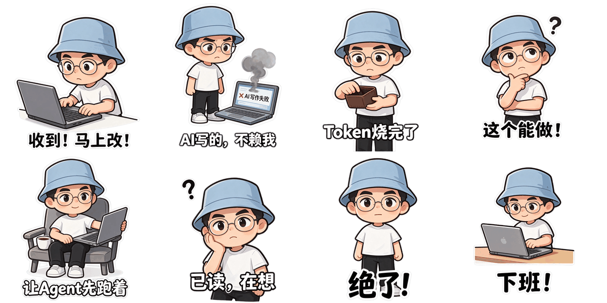
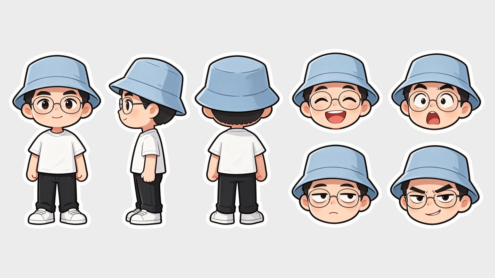

# huashu-selfie-sticker

一张自拍，做一整套透明底的动态表情包。



上面这8个表情是用这个 skill 做出来的：一张照片先画成Q版角色设定图，再用设定图当参考，让每个表情画成一张4×2的精灵图（8格是一段连续动作，底下一句同样的字幕），最后用脚本切帧、对齐、合成GIF。



## 它做什么

- 第一步：照片 → Q版角色设定图（正面、侧面、背面＋四个表情），把形象锁住
- 第二步：设定图 → 每个表情一张精灵图，透明背景
- 第三步：精灵图 → 每一帧的PNG、480和240两个尺寸的透明GIF、保留半透明边缘的APNG，以及所有表情同时动的总览GIF

生图需要一个能传参考图、能出透明背景的图像模型。作者实测用的是即梦里的 Seedream 5.5（16:9，2K，背景选「透明背景」），9张图都是一次出的，8套64格字幕没有错字。

## 安装

把仓库克隆到你的 agent 的 skills 目录里，例如：

```bash
git clone https://github.com/alchaincyf/huashu-selfie-sticker.git ~/.claude/skills/huashu-selfie-sticker
```

切帧脚本需要 Python 3、Pillow 和 numpy：

```bash
pip install pillow numpy
```

## 用法

对你的 agent 说「用这张照片帮我做一套动态表情包」，把照片给它。它会按 `SKILL.md` 一步步来：先出提示词（或直接调用你能用的图像模型），角色设定图让你确认像不像，再一起定表情和字幕，最后切帧出GIF。

只想用脚本也可以：

```bash
python3 scripts/make_gif.py 精灵图.png 4 2 gif/收到马上改 200
python3 scripts/overview.py   # 把 gif/ 下所有表情拼成一张总览GIF
```

要上架表情平台的话，先去平台查当下的尺寸、大小和帧数要求，这里的240版本不保证合规。

## 经验会越用越多

`经验.md` 记着用过的人踩到的坑和管用的写法，skill 每次开始前会读它，做完会把新发现补进去。

## 关注作者


---

## English

Turn one selfie into a full set of animated stickers with transparent backgrounds.

1. Photo → a chibi character sheet (front, side, back, four expressions) to lock the look.
2. Character sheet → one 4×2 sprite sheet per sticker: 8 frames of a continuous action, same caption on every frame, transparent background.
3. Sprite sheet → per-frame PNGs, transparent GIFs at 480px and 240px, an APNG that keeps soft edges, and an overview GIF of the whole set.

You need an image model that accepts reference images and outputs transparent backgrounds. The author used Seedream 5.5 in Jimeng (16:9, 2K, transparent background). Install by cloning this repo into your agent's skills folder, then `pip install pillow numpy` for the frame-cutting scripts. Ask your agent: "make an animated sticker set from this photo."
